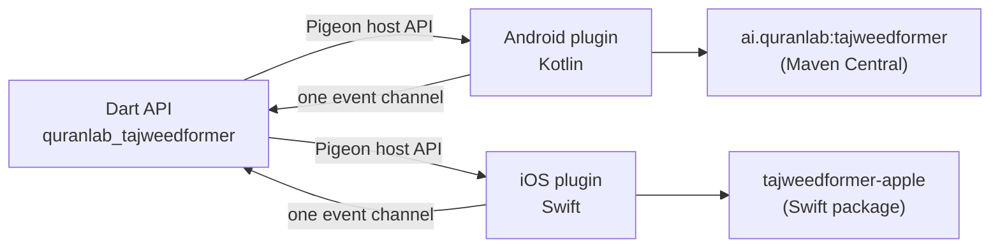

# TajweedFormer for Flutter: reference for coding assistants

Everything an assistant needs to integrate this SDK correctly: use only the names, calls and settings shown here or in the installed version's sources. People: the short version is in [README.md](README.md).

## What you get

<table>
<tr>
<td width="33%" valign="top">

**Hears the recitation**<br>Streaming recognition of Quranic recitation: audio in, and what the model heard comes out as often as every 160 ms on the CPU engine (320 ms by default, including on the Neural Engine and the NPU; 480 ms for longer context).

</td>
<td width="33%" valign="top">

**Every output of the model**<br>The sounds it heard with confidence and timing, and every head of the network per chunk (lengthening, gemination, ghunna, qalqalah and more): yours to build on.

</td>
<td width="33%" valign="top">

**One plugin, two platforms**<br>A Dart API over the native Android and iOS SDKs, with their names. It runs on the CPU on every device, and on the Neural Engine or the NPU where the device's build passes its self-test.

</td>
</tr>
<tr>
<td valign="top">

**Private by default**<br>Offline, on the device. A recording leaves it only when the learner agrees to share it.

</td>
<td valign="top">

**Nothing to host**<br>The SDK downloads the right model for each device (56.5 MB to start) from Quran Lab's servers, verifies it and keeps it up to date.

</td>
<td valign="top">

**Data for your own judge**<br>The SDK scores nothing. The model's thresholds come with it as read-only data, so your app can judge a recitation its own way. The expected units of each ayah do not: with this release and the model build served now, `model.reference` is null.

</td>
</tr>
</table>

## Why TajweedFormer

- **Made for the Quran.** Trained on Quranic recitation, with its own sound units and heads for what tajweed is about.
- **Feedback in the moment.** Output streams while the learner recites, so your app can respond on the word itself, not after the take.
- **One engine on every platform.** The same engine runs the [Android](https://github.com/Quran-Lab/tajweedformer-android), [iOS and macOS](https://github.com/Quran-Lab/tajweedformer-apple), [web](https://github.com/Quran-Lab/tajweedformer-web) and [Windows and Linux](https://github.com/Quran-Lab/tajweedformer-c) SDKs, all set from one portal.
- **Free, and it stays free.** Quran Lab is a non-profit waqf: the SDKs and models are never sold. The licence, NPL-1.3, and Quran Lab's access terms ask three things: no paywall on model features, no output presented as an authoritative religious ruling, and no training of other models on the model or its outputs. A line telling learners that automatic feedback can be wrong is encouraged, not required.

## Built for AI developers

Copy the setup prompt from [sdk.quranlab.ai](https://sdk.quranlab.ai) and paste it into your coding assistant. That one prompt sets everything up: the package, your key, and the first calls. [AGENTS.md](AGENTS.md), beside this README, gives the assistant the complete API, so the code it writes uses names that exist. Prefer to do it by hand? Get a key in the portal and start below.

## At a glance

- **What it is:** one Flutter plugin, `quranlab_tajweedformer`, for Android and iOS. It is a thin layer over Quran
  Lab's native SDKs 4.0 and carries no copy of either: on Android it depends on Maven `ai.quranlab:tajweedformer`
  4.0.2, on iOS on the Swift package `Quran-Lab/tajweedformer-apple` 4.0.3 (exactly these versions, the ones it is
  built and tested with), and it uses only their public API. The Dart API has the native
  SDKs' names and shapes: a `TajweedClient` (the app's key, one per process), a `TajweedModel` (a verified model
  on the device), a `TajweedSession` (one take), the `TajweedHeads` (the model's output) and the `TajweedBackend`
  (the CPU engine or the device's accelerator). Every failure is one Dart type, `TajweedError`, with the native
  SDK's code, message, fix and docs link.
- **Inference only:** the SDK gives the model's output and judges nothing. What an app needs for a judge of its own
  ships as read-only data (`model.calibration`, `model.reference`).
- **The microphone:** `model.listen()` uses the native SDK's own microphone (interruptions, route changes and the
  app leaving the foreground included), so the plugin itself needs no audio package. An app that captures audio
  itself pushes 16-bit or float PCM into `model.session()`. The optional package `quranlab_tajweedformer_record`
  (in `packages/`) does that with the `record` plugin.
- **The protected model:** the model is encrypted for each install and runs only inside the Quran Lab Core, a
  closed library in each native SDK, under a lease Quran Lab signs for the install. The first run needs a
  connection; after that the model works offline, and the SDK keeps itself up to date in the background when the
  device is online. No call gives a model file or its path. See "The lease".
- **Recitation sharing:** the native SDK shows Quran Lab's own consent sheet itself, over the Flutter activity on
  Android and the Flutter view controller on iOS. Every learner is asked, and the choice is theirs; there is nothing
  to switch on or off in code.
- **Analytics and error reports** are always on: anonymous daily counts and durations, and a small report of each
  failure (where and why, never a message or an identifier). No option turns them off; only Quran Lab can, from its
  signed config.

## Install

```sh
flutter pub add quranlab_tajweedformer
```

Flutter 3.41 or later. On iOS the app uses Flutter's Swift Package Manager integration (on by default since Flutter
3.44): the Apple SDK ships only as a Swift package.

## Before you start

| | |
| - | - |
| **Key** | An apps key from [sdk.quranlab.ai](https://sdk.quranlab.ai) for your app's Android package name and iOS bundle id. On the Android emulator and the iOS Simulator, a development key: Quran Lab leases the Core's emulator and Simulator builds to development keys only. |
| **Android** | Android 8.0 (API 26) or later: `minSdk = 26`. Phones and tablets are `arm64-v8a` and `armeabi-v7a`; `x86_64` runs the CPU engine only, on the emulator and x86 Chromebooks. The plugin brings `ai.quranlab:tajweedformer:4.0.2`; do not add it yourself. On your key's page, under "Signing certificates (SHA-256)", add the app signing key certificate and the upload key certificate: until you do, your installs are not hardware-verified for your app. At 4.0's launch every phone runs the Core's CPU engine. |
| **iOS** | iOS 15 or later on Apple silicon (devices and the arm64 simulator), Xcode 16 or later, and Flutter's Swift Package Manager integration (the Apple SDK ships only as a Swift package). `NSMicrophoneUsageDescription` in `Info.plist`. The App Attest capability: with it an install is hardware-verified, may use the Neural Engine, and uploads shared recordings. Exclude x86_64 from Simulator builds (`EXCLUDED_ARCHS[sdk=iphonesimulator*] = x86_64`): the Core is arm64 only. |
| **Download** | Making the client downloads nothing. The first `client.model()` or `client.prefetch()` downloads the model, encrypted: 56.5 MB, once (73.8 MB on disk), and needs a connection. |
| **Offline** | The first `client.model()` or `client.prefetch()` needs a connection; after that the model works offline, and the SDK keeps itself up to date in the background when the device is online. `needs_connection` means the SDK needs Quran Lab to continue. A model that is open keeps running. |
| **Model** | The model runs only inside the Quran Lab Core, which comes with the native SDKs: its files are encrypted from Quran Lab's server to the device, and no plain model file is ever written. When Quran Lab refuses the key or the app, the model's files are removed. |
| **Analytics** | Anonymous counts and durations (never audio, text, names or device identifiers) and reports of the failures your learners hit are always sent; you find them at sdk.quranlab.ai under your app, Problems included. |
| **Takes** | A model runs one take at a time; a take holds at most 20 minutes of audio. |

## Quick start

```dart
Future<void> quickStart(void Function(String heard) show) async {
  final client = await TajweedClient.create('qlk_v1_...'); // your key from sdk.quranlab.ai; one client per process
  final model = await client.model(); // the first call downloads and verifies the model
  final session = await model.listen( // the SDK's own microphone: it asks for the permission itself
      options: const TajweedSessionOptions(endOnSilenceMs: 1500));
  await for (final chunk in session.chunks) { // every 320 ms, until 1.5 s of silence end the take
    show(chunk.decoded.text); // what the model heard so far
  }
}
```

These are the four calls of every Quran Lab SDK: client, model, listen, read. The code is
[`example/lib/quick_start.dart`](packages/quranlab_tajweedformer/example/lib/quick_start.dart), which CI compiles.
The example app beside it ([`example/lib/main.dart`](packages/quranlab_tajweedformer/example/lib/main.dart)) is
one screen around those calls: the model loading with its download progress, "Play sample" (a sample clip, no
microphone), "Recite", the tokens as they come (tentative ones dimmed), "Stop", "Diagnose" and the sharing
settings. Run it with a key made for its identifiers (`ai.quranlab.tajweedformer.flutter.example` on both
platforms): `flutter run --dart-define=QURANLAB_KEY=qlk_v1_...`. To run it as another app id that your key names,
set `QURANLAB_APPLICATION_ID` for the Android build. On the Android emulator and the iOS Simulator use a development
key: Quran Lab leases the Core's emulator and Simulator builds to development keys only.

- **The microphone.** `model.listen()` asks for the permission when it has to (a refusal is the error
  `microphone_denied`), captures at the device's own rate and carries that rate to the take. No sample rate
  appears in your code. iOS needs `NSMicrophoneUsageDescription` in `Info.plist`.
- **The end of a take.** With `endOnSilenceMs` (500 to 60000) the take finishes by itself after that much silence
  following speech: the last chunk has `decoded.isFinal`, `chunks` ends, and `session.finish()` returns the take's
  heads. Silence is what the model hears as silence (a held vowel is speech), so in a noisy room a take may not end
  on silence: keep a Stop button that calls `session.finish()`. A take holds at most 20 minutes of audio.
- **Background.** A `listen` take ends when the app leaves the foreground (`TajweedEnded(background)`); start a new
  one when the app comes back.

## What the plugin gives

One take gives chunks while it runs and the take's heads when it ends. A `TajweedChunk` (every 320 ms at the
default context) carries:

- **The heads** (`chunk.heads`): every selected head of the network for this chunk, as a `Float32List` of
  `frames * classes` values, row major (`TajweedHead`: `name`, `kind`, `frameMs`, `frames`, `classes`, `values`,
  `at(frame, class)`). The CTC heads (`log_probs`, `inter1_log_probs`, `timing_log_probs`, ...) are
  log-probabilities over the model's tokens; the attribute heads (`gem`, `attr_*`) are probabilities; `boundary`
  and `conf` are logits. `TajweedSessionOptions(heads: ...)` selects them by name (`TajweedSessionOptions.allHeads`
  for all twelve); the default is the six of `TajweedSessionOptions.defaultHeads`. `heads.greedy(name)` is the
  greedy reading of a CTC head.
- **The decoded layer** (`chunk.decoded`): what the model heard in the take so far: `tokens` (each with `id`,
  `name`, `firstMs`, `peakMs`, `lastMs`, `confidence`), `words` (split at the word bar), `text`, and per 40 ms
  frame the top token, its log-probability, the runner-up and the margin (`frames`; with `topK` also the K best).
  The first `settled` tokens will not change any more; the ones after them may still grow or be replaced. On the
  last chunk `isFinal` is true.
- **Speech** (`chunk.speech`): whether the model heard speech in this chunk, from its own output.

Events come beside the chunks, on `session.events`: `TajweedSpeechStarted`, `TajweedSpeechEnded`,
`TajweedInterrupted` (a `listen` take: a call, another app, a route change), `TajweedResumed`,
`TajweedBackendChanged` (the take moved from the accelerator to the CPU engine; the chunks from `fromChunk` on come
again with the same indexes and replace the ones you have) and `TajweedEnded` with its reason (`silence`,
`background`, `interrupted`, `sourceEnd`, `limit`, `error`).

At most 256 chunks and 64 events wait for a reader that is late; the oldest are dropped first, never the last
chunk or `TajweedEnded`. Nothing is lost with them: each chunk's `decoded` is the take so far, and `finish()`
returns the whole take. `session.finish()` returns the take's `TajweedHeads` (`heads.decoded()` is its final
decoded layer); `session.cancel()` ends the take and keeps nothing. A model has one open take at a time
(`session_open` otherwise).

## Your own audio

```dart
final session = await model.session(options: const TajweedSessionOptions(sampleRate: 16000));
await session.pushInt16(pcm16);       // or session.push(float32Samples), mono, -1..1
final heads = await session.finish(); // takes every push made before it first
```

`sampleRate` is 8000 to 48000 (16000 by default, the model's own rate). Pushes keep their order, and each returned
future completes once the engine has taken the samples. An app that captures audio outside takes can also feed it
to the sharing recording (`client.sharing.feed(...)`), so a shared recording is not cut at a take's edges.

The optional package `quranlab_tajweedformer_record` captures 16 kHz mono PCM with the `record` plugin and pushes
it into a take: `final mic = TajweedRecorder(); final session = await mic.start(model); ... await mic.stop();`.

## Without a microphone

A model carries a few short real recitations, its self-test clips (`model.sampleClips`).
`model.listenFrom(clip)` runs one through the same path as the microphone, and `model.listenFromSamples(samples,
sampleRate)` does it for audio the app already has; `pace: TajweedPace.fast` feeds it as fast as the engine takes
it. The take ends with `TajweedEnded(sourceEnd)`. This is how an example, a test or an emulator shows real output
with no microphone.

## The client and the model

- `TajweedClient.create(key, options: ...)` makes the process's one client. The same key again gives the same
  client (also after a hot restart); another key while one is open is `client_exists`. `TajweedClientOptions`
  takes `appId`, `appVersion` and `storage`.
- `client.model(onProgress: (done, total) {...})` gives the model version Quran Lab's signed config recommends for
  this app, downloading and verifying it on the first call and reporting the download's bytes; `version: '4.0.0'`
  pins a version. `client.prefetch()` downloads ahead of use. Downloads use whatever network the device has: nothing
  waits for Wi-Fi.
- `model.contexts`, `model.defaultContext` and `model.chunkMs(context)` say which response times the model has;
  `TajweedSessionOptions(context: ...)` picks one for a take.
- `client.diagnose()` answers "why does it not work" in one object (`.json` for a bug report): the SDK version, the
  key, the config, the model, the backend, the microphone, storage, the last error and the connection.
- `client.storage()` says what is on the device, `client.removeModels()` deletes it.
- A model comes only from Quran Lab's server, through the client: no call opens a model folder an app ships. When
  Quran Lab refuses the key or the app (a revoked key, a paused or blocked app), the native SDK stops running the
  model and removes it from the device, but only once its Core has verified the signed refusal.

## The lease

- **A lease per install.** The model opens under a lease Quran Lab signs for this install. The first run needs a
  connection; after that the model works offline. When the device is online the native SDK keeps itself up to date
  in the background, and opening the model never waits for that. An attested install (Android: the phone's hardware
  Key Attestation, or Play Integrity on a phone without it; iOS: App Attest) is hardware-verified, the class that may
  use the device's accelerator.
- **`needs_connection`** from `client.model()` means the SDK needs to reach Quran Lab to continue; an answer from a
  server that is a failure is `download_failed`. A model already open keeps running until it is closed.
- There is no option for any of it: what the app sees is the model opening, or the errors above.
  `client.diagnose().protectedModel` says where the install's key lives and the state and class of the lease the
  Core holds, for support.

## Backup servers

If Quran Lab's main servers can't be reached, the SDK uses backup servers automatically. There is nothing to set;
`client.diagnose().endpoints` says which servers it is using.

## Errors

Every failure is a `TajweedError` with a `code` from the one list every Quran Lab SDK shares
(`TajweedErrorCode`, 26 codes: `invalid_key`, `needs_connection`, `model_unavailable`, `microphone_denied`,
`session_open`, ...), a `message`, a `fix` and a `docs` link (`https://sdk.quranlab.ai/docs/errors#<code>`). The
plugin passes the native SDK's own error through unchanged, one to one. Catch the one type and show or log the
message and the fix. On a platform this package does not run on, every call fails with `runtime_unsupported`.

A failure the native SDK reports also carries `cause` (`TajweedErrorCause`): where it failed and why (`stage`,
`reason`, and `httpStatus`, `errorName` and `errorCode` when there are any), the same words as the report the SDK
sends Quran Lab. Log it, or send it with a support request. On `needs_connection`, `cause.needs` says what is
missing: `model`, the model files are not on the device yet (connect to download them); `lease`, the model is on the
device and needs Quran Lab's answer to open (connect to continue). The five codes that only say the API was used
wrongly carry no cause.

| What happened | Code |
| - | - |
| A request the call needs got no answer at all (offline, DNS, a refused connection): the SDK needs to reach Quran Lab to continue, for example before the model is on the device | `needs_connection` |
| Quran Lab or the CDN answered with a failure: a server error, a 429, a redirect | `download_failed`; call again later, a download resumes |
| A downloaded file does not match the signed manifest | `checksum_mismatch` |
| Quran Lab refused the key or the app | `invalid_key`, `server_rejected` with the reason, or `sdk_too_old` |

The native SDKs also send Quran Lab a small report of each error your app gets (but the five that only say the API
was used wrongly: `invalid_argument`, `client_exists`, `session_open`, `session_closed`, `cancelled`) and of the
failures they go on from without telling it: where it failed, why, how often that day, and the device's model code
and memory tier. Never a message, a path, a URL or an identifier. Your app's page at sdk.quranlab.ai lists them under
Problems. Nothing to do in Dart.

## Recitation sharing

Every learner is asked, and the choice is theirs: nothing is recorded for sharing and nothing is sent before the
learner taps "Share" on the consent sheet, a learner who never answers never shares, and a learner can say "Not
now", stop, or delete what they shared at any time. Every app shows the same sheet under the same rules. There is
nothing to switch on in code, and nothing to switch off. `flags.contributions` in the signed config is Quran Lab's
own switch, for every app (a platform not offered yet, or an incident), never the app's: while it is off,
`isAvailable()` is false and nothing is asked.

- **The sheet** is the native SDK's own, in the learner's language, with Quran Lab's design, shown by the native
  SDK itself over the Flutter activity (Android) or view controller (iOS), only while the app is in front and no take
  is open. The first ask comes never in the install's first 24 hours nor before its third finished take; after "Not
  now" a small card asks again after 14 days and 7 takes, then 30 days and 10; three asks at most, ever, and a yes is
  never asked again.
- **The settings:** `client.sharing.openSettings()` shows the SDK's settings screen over the app: the switch, "What
  is shared", "Delete what I shared" and the learner's recovery code. Put it behind a row of your settings screen.
- In code: `client.sharing.isAvailable()`, `isOn()`, `setOn(on)` (the learner's own switch, for an app that draws
  its own row), `ask()` (the app's own moment, under the same rules: false when no ask is due), `setWording(...)`
  (your own words for the sheet), `setTheme(SharingTheme(...))` (colours and corner radius), `items()`, `summary()`,
  `delete()` and `recoveryCode()`.
- **Takes in a row** make one shared recording when they come within Quran Lab's join window (3 seconds unless its
  config sets up to 60).

## The two platforms

**Android.** The plugin depends on `ai.quranlab:tajweedformer` at exactly the version it was built and tested
with, through its public API only; do not add the SDK to your app yourself. Android 8.0 (API 26) or later: set
`minSdk = 26` in `android/app/build.gradle.kts`. The SDK's manifest brings `RECORD_AUDIO`, `INTERNET` and
`ACCESS_NETWORK_STATE`. Since 4.0 the SDK finds the activity in front also when the client is made after it, as a
Flutter app makes it, so it shows its own sharing sheet and asks for the microphone itself.

- **Signing certificates.** On your Android key's page at sdk.quranlab.ai, add the app signing key certificate and
  the upload key certificate (SHA-256). Until you do, your installs are not hardware-verified for your app.
- **The NPU** needs LiteRT, which is the app's own and optional (`com.google.ai.edge.litert:litert` 2.2.0 or later);
  at 4.0's launch every phone runs the Core's CPU engine.
- **The emulator** runs the Core's x86_64 build, leased to development keys only; a production key gets
  `server_rejected` there.

**iOS.** iOS 15 or later on Apple silicon (devices and the arm64 simulator), Xcode 16 or later. The Apple SDK
ships only as a Swift package, so the app must use Flutter's Swift Package Manager integration, on by default
since Flutter 3.44 (`flutter config --enable-swift-package-manager` on an older setup); an app still on CocoaPods
gets a message that says so at `pod install`. Add `NSMicrophoneUsageDescription` to `Info.plist`. Add the App
Attest capability: with it, hardware-verified installs, the Neural Engine and uploads of shared recordings; without it
the SDK still runs, on the CPU engine only. On the Simulator use a development key. The Core is built for
arm64 only (devices and the Apple silicon Simulator): add `EXCLUDED_ARCHS[sdk=iphonesimulator*] = x86_64` to
`ios/Flutter/Debug.xcconfig` and `Release.xcconfig`, as the example does, since `flutter build ios --simulator` also
builds x86_64.

## How it works



The calls go through a Pigeon host API (`pigeon/messages.dart`, generated into Dart, Kotlin and Swift), and the
chunks, events and download progress of every take come back through one event channel. Head values and pushed
samples travel as little-endian float32 or int16 bytes. The decoded layer travels as a delta: each chunk carries
only the tokens and frames that changed since the one before, so a long take does not send its history every 320
ms; the Dart side rebuilds the whole layer, and a decoded layer the app already holds never changes.

## Build and test

```sh
# optional, for an Android SDK candidate before Maven Central has it: QURANLAB_AAR=<its .aar file>
cd packages/quranlab_tajweedformer
flutter pub get
flutter analyze
flutter test                                   # the Dart API against mocked platform channels
cd example
flutter build apk --debug                      # the example app on Android
cd android && ./gradlew :quranlab_tajweedformer:testDebugUnitTest   # the Kotlin unit tests
```

`integration_test/e2e_test.dart` is the whole 4.0 path on a device or emulator against Quran Lab's servers (the
lease, the download, the 35 conformance clips against the Core gate's file, an error report); its header says
which files it reads from the app's own folder. CI runs everything else on Quran Lab's Linux runner.

`dart run pigeon --input pigeon/messages.dart` regenerates the three channel files after a change of the interface.
The iOS side builds on a Mac: `flutter build ios --simulator` in `example/`.

## Status

4.0.3 on pub.dev (`quranlab_tajweedformer` and `quranlab_tajweedformer_record`), over the Android SDK 4.0.2 and the
Apple SDK 4.0.3. The plugin builds and passes its tests against both. The 4.0 end-to-end test passed with 4.0.0 on
the Android emulator, the iOS Simulator and an iPhone (App Attest, the hardware-verified install, the Neural Engine),
and with 4.0.2 on the iOS Simulator.

Quran Lab encourages, but does not require, one line where your app shows feedback built on the model, for
example: "Automatic tajweed feedback can be wrong. It does not replace a qualified teacher." Any honest wording
is fine.

## Problems and wishes

Something does not work, something is missing, or you want to tell us how it went:
[open an issue](https://github.com/Quran-Lab/tajweedformer-flutter/issues/new/choose). There is a form for a bug, one for a
wish and one for a word of feedback. Issues are public, so leave out keys and anything that came from a learner.
A security problem does not go into an issue: use "Report a vulnerability" on the
[Security tab](https://github.com/Quran-Lab/tajweedformer-flutter/security). A coding assistant can file an issue for you; it
shows you the text first.

## Licence

Quran Lab is a waqf: the SDKs and the models are free to use and are never sold.

The source code in this repository and the TajweedFormer model weights are released under the
Quran-Lab No-Profit License 1.3 ([NPL-1.3](LICENSE)): use, copy, modify and build apps on them freely,
but never charge for them, for access to them, or for any feature they power. Neither they nor their outputs may be used to train other models. The weights are not
stored in this repository; Quran Lab hosts them itself and serves them to apps by
`cdn.quranlab.ai/models` under the same licence. Get access at
[sdk.quranlab.ai](https://sdk.quranlab.ai).

Third-party components keep their own licences, listed in their folders under `third_party/`.
